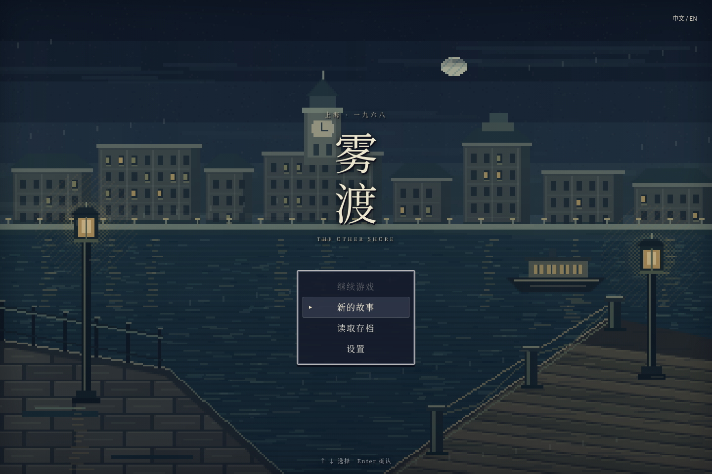
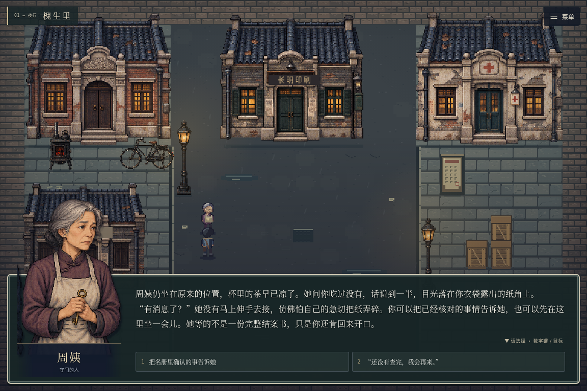
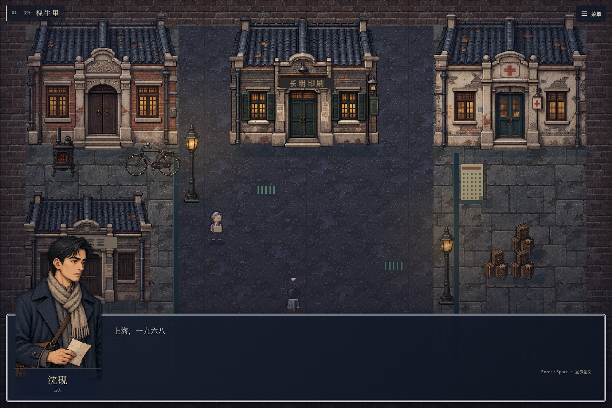
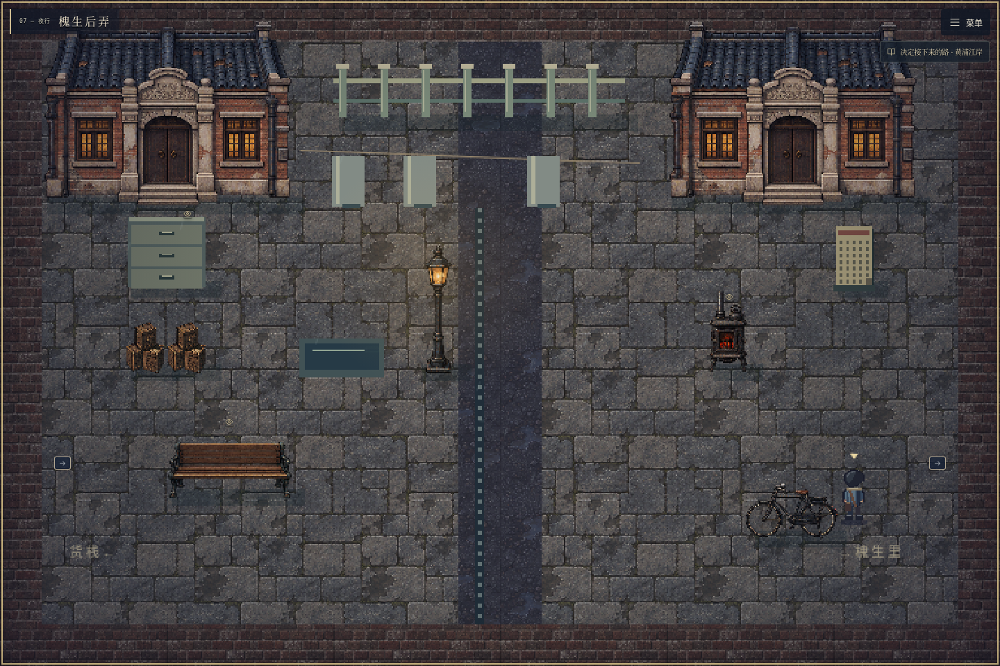
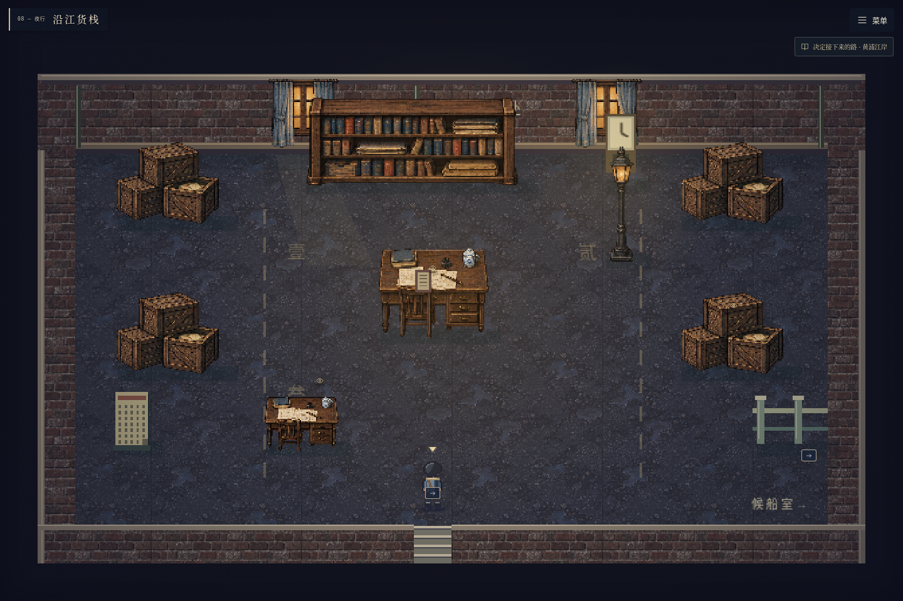
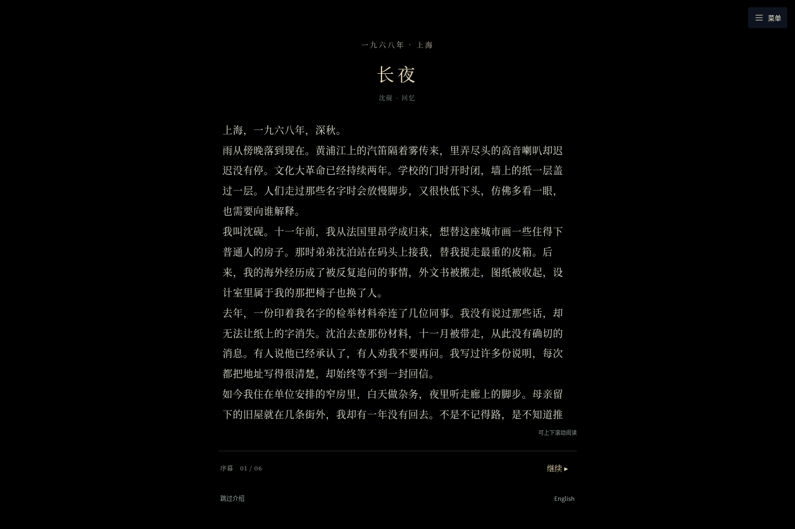

# 雾渡 · The Other Shore

一款可直接游玩的原创 **RPG Maker 风格 2D 网格探索 / 视觉小说 Web 游戏**。故事发生在 1968 年深秋的上海：归国后遭受政治迫害的沈砚，循着失踪弟弟的一封信回到旧里弄，在监视与沉默中寻找真相。

采用 **TypeScript + HTML5 Canvas + Vite**，以 32 × 32 像素网格、俯视地图、四向行走、半身立绘与底部对话框呈现。它模拟经典 RPG Maker 的游玩方式，**不是需要 RPG Maker 软件打开的编辑器工程**。全部人物、地点与具体情节均为原创虚构；无战斗、无倒计时。





美术包含五位角色的透明半身立绘、石库门建筑、旧式家具与六类地形纹理。角色行走图采用独立的 32×48 像素蒙版和四步动画，与立绘服装配色一致。详见[美术资源与替换说明](src/assets/README.md)。







## 直接打开游戏

1. [下载 main 分支的完整游戏 ZIP](https://github.com/LBLing114/rpg-game/archive/refs/heads/main.zip) 并**解压**，或在仓库点击 **Code → Download ZIP**。
2. 用 Chrome、Edge 或 Firefox 打开根目录的 **`play.html`**。
3. 在开始界面选择 **新的故事**；已有进度选择 **继续游戏**，或用 **读取存档** 指定档位。

`play.html` 是包含代码、剧情、样式和全部美术的单文件游戏，无需安装 Node.js。也可在 GitHub 的 `play.html` 页面点击 **Download raw file** 单独下载；不要保存 GitHub 预览网页。浏览器可能限制本地文件存档，稳定保存进度可使用下方本地服务。

## 开发与本地预览

需要 **Node.js 22.12 或更新版本**。在项目文件夹中打开终端：

```bash
npm install
npm run dev
```

保持终端开启，在**运行这些命令的同一台电脑**打开终端给出的地址，默认 `http://localhost:5173`。已有锁文件时可用 `npm ci` 做可重复安装。云端运行时，请使用平台的 **5173 端口转发地址**；自己电脑上的 `localhost` 无法访问云端进程。

```bash
npm run build
npm run preview -- --port 4173
```

构建执行 TypeScript 检查、生成 `dist/`，并更新可双击运行的 `play.html`。预览默认 `http://localhost:4173`。`dist/` 可部署到静态网站，支持仓库子路径；请通过 HTTP 打开 `dist/index.html`。

运行时无需 CDN、外部图片或字体、账号、API 密钥或后端；安装完成后可离线游玩。

页面只显示游戏画面，不再包含外部导航、章节栏、装饰外框或页脚。右上角 **☰ 菜单**（或 **Esc**）可打开背包、手记、地图、结局、语言、存档 / 读档、设置及游玩指南。画面保持原始比例，按窗口尺寸缩放。

## 内容与操作

- **九张地图**：槐生里、沈家旧屋、长明印刷铺、仁安诊所、旧档案室、黄浦江岸，以及新增的槐生后弄、沿江货栈、夜航候船室。使用砖墙、旧海报、石板路、室内木地板和家具，没有大片草地。
- **完整故事**：五章流程、205 个双语对话节点、两次证据推理、四条独立后半程与八种结局。共有 28 项任务定义，每条路线显示相关的 19 项（含三项可选任务），七件可查看和使用的剧情道具。
- **网格探索**：每秒 176 像素的连续四向移动，跨格保留剩余位移，支持途中立即反向、短按转向缓冲，连续点击新目的地不会退回格子中心。地形与家具碰撞、点击地面寻路、走近人物后交互；角色与场景按脚底 Y 坐标遮挡。出入地图会落在对应门口，地图内选择当前地点保留原位置。
- **经典对话**：深色半透明白边窗口、五位角色的透明半身立绘、逐字文字、分支选择、可开启的文字与菜单提示音。角色发言显示立绘，书桌、墙面等物件旁白使用标题与正文，不显示人物或船的占位图。
- **开始界面**：独立绘制的江雾码头像素背景（旧上海远景、渡船、石岸与旧式路灯）、竖排标题与经典文字菜单；支持方向键选择、Enter 确认、鼠标和触屏。
- **双语与存档**：界面和全文中英文切换；一个自动档、三个独立手动档位、已发现结局收集；保存当前场景、网格位置、道具、选择和对话节点。

| 操作 | 键盘 | 鼠标 / 触屏 |
| --- | --- | --- |
| 行走 | WASD / 方向键 | 点击可行走地面，自动绕过障碍 |
| 与附近人物或物件交互 | Enter / Space / E | 点击标记，角色走近后触发 |
| 显示整段文字 | Enter / Space / E | 点击对话框的继续按钮 |
| 推进单选段落 | 文字显示完成后 Enter / Space / E | 点击对应选项 |
| 选择分支 | 文字显示完成后 1–5 | 点击选项 |
| 背包 / 使用道具 | I | 菜单 → 背包，再选择物品和使用按钮 |
| 任务手记 | J | 菜单 → 手记 |
| 街区地图 | M | 菜单 → 地图，选择已解锁地点 |
| 打开 / 关闭菜单 | Esc | 右上角 ☰ 菜单 / 关闭按钮 |
| 手动存档 / 读档 | Esc → 存档 / 读档 | 菜单 → 存档 / 读档 → 对应档位的保存 / 读取 |
| 中英文与音效 | 菜单中的设置 | 菜单 → English / 中文；设置 → 音效 |

点击 **新的故事** 后，先进入独立的全屏序幕：纯黑幕、淡入文字、分段标题与年代标记；开头旁白约 531 个汉字，依次交代文革时期的上海、沈砚在法国里昂留学与 1957 年归国、此后的政治迫害、沈泊在 1967 年失踪，以及一封旧信为何在今晚送达。六段读完后，画面淡入槐生里的地图探索。长文可以上下滚动阅读。

按 **Enter / Space** 或点击按钮显示全文并继续；可用 **跳过介绍** 直接进入地图，也可在序幕底部切换语言。序幕每段自动保存，中途退出后从开始界面选择 **继续游戏** 即可接着读；已经进入探索的存档不会重新播放。菜单中的 **故事背景** 可随时重读，不改变进度。



每条完整路线以 **约一小时**为目标。目前按最直接的有效路线统计，有 **92–98 段正文、约 1.19–1.27 万个中文汉字 / 6,875–7,334 个英文词**，正常阅读和探索估算约 **50–70 分钟**。估算采用中文每分钟 240–300 字、英文 140–180 词，加上 12–18 分钟的探索与选择；不是强制计时，也尚未经过真人试玩计时。快速阅读、跳过序幕或地图传送会缩短时间；支线和重访会增加时间。`npm run report:routes` 可重新统计每个结局的阅读量，详见 [完整路线说明（含剧透）](docs/story-flow.md)。

关键选择有独立后续：是否公开询问邻居会改变后来的寄存对话；署名、轮值、核对接应、保留草稿等决定会开放或关闭相应结局。江岸选择后，必须完成当前路线的三段实地事件，才会在候船室问讯窗口进行最终选择，并播放三段结局后果。

先和周姨交谈取得旧屋钥匙，去旧屋读书桌里的回执，再调查印刷铺铅字盒，与林岚核对后取得校样。诊所需先读值夜登记，再听医生证言；档案室需先查索引，再核对名册。两次推理选错会给出解释并允许重试，不消耗道具。取得名册后，继续调查 **后弄退信箱 → 货栈点交桌 → 候船室旧航班表**，再去江岸选择路线。新区域可以沿出口连续步行，也可用 M 打开地图传送。地图会显示地点解锁条件，金色标记与任务提示会提示下一处地点。背包中的物品会提示使用地点；到达相应场景使用，可引导角色走到目标并开启相关对话。场景时间仅用于叙事，没有限时选择。

旧版存档保留道具、选择、已收集结局和三个手动档位。拿到名册的旧进度可直接前往后弄补完调查；不会凭空完成新增任务。已到旧结局的进度可点击“回到本路线的最后选择”，退出江岸对话后继续调查。若想从头体验，在标题选择 **新的故事**（可先手动存档）。

**建议在江岸选择路线前保存一个手动档。** 选择后进入独立路线，不能靠回访累加另一条路线。结局后的返回按钮只回到本路线最后选择，并保留早先选择的限制；体验其他路线需要读取分线前的存档。

### 开始与存档

- **继续游戏**：读取最近的一份有效存档（自动或手动）。没有存档时显示为不可选。
- **手动保存**：游戏内按 Esc → **存档 / 读档** → 选择档位 1、2、3 的 **保存**。对话中也能保存，读取后会从当前段落重新显示文字。已占用档位会先询问是否覆盖。
- **读取进度**：开始界面的 **读取存档** 可查看自动档和三个手动档，列表显示章节、场景及保存日期。游戏内读取会先确认替换当前进度。
- **返回标题**：Esc → **返回标题**，先保存当前进度。进入标题、修改设置、切换语言或在标题页刷新，都不会用初始状态覆盖进度。
- **重新开始**：只替换自动档，保留三个手动档位与结局收集。旧版本的唯一手动存档直接显示为 **档位 1**，无需迁移操作。

进度保存在浏览器当前站点的 `localStorage`，不跨设备同步。请使用同一浏览器及同一网址；更换端口、清除网站数据或在隐私窗口关闭浏览器，可能无法保留进度。浏览器拒绝写入或存储空间不足时，游戏会明确提示保存失败，不会显示保存成功；当前故事仍可继续。结局后可返回最后选择，或回访角色补齐线索。旧版连续坐标存档会恢复到当前地图的可行走网格。

详细章节路线与时长依据见 [扩展序章流程（含剧透）](docs/story-flow.md)。

## 剧情与地图扩展

```text
src/
  data/storyData.json  双语剧情、对话分支、任务、物品、结局与条件
  story.ts        JSON 数据适配与条件判断
  grid.ts         32px 网格、九张地图、碰撞、路径查找与交互位置
  movement.ts     连续跨格移动、输入缓冲、反向与鼠标重定向
  art.ts          图块与物件合成、Y 排序与天气
  title-art.ts    开始界面的独立像素江岸画面、薄雾与雨景
  characters.ts   四向行走精灵、像素蒙版与动画
  illustrations.ts  图集加载、裁切与纹理缓存
  assets/         角色立绘、建筑、家具、地形及美术说明
  engine.ts       状态转换、地点解锁、存档校验
  saves.ts        三个手动档位、自动档与旧档兼容
  main.ts         界面、逐字对话、操作与道具使用
  audio.ts        合成环境音与交互音效
  style.css      RPG 窗口、菜单与响应式布局
```

文字均采用 `{ "zh": "中文", "en": "English" }`。`routes` 数组定义四条路线、任务地点与八个结局；对话选择用 `flags` 记录决定，地点对话支持嵌套条件选择器，任务的 `when` 控制相关路线的显示。`prologue` 数组定义序幕的节点顺序、双语标题与年代；正文复用对应对话节点，保持旧存档兼容。编辑 `src/data/storyData.json` 的 `dialogues` 添加节点；每个节点提供 `speaker`、`portrait`、`text`、`choices`。选择可包含 `next`（节点 ID）、`items`（赠送道具）、`flags`（决定）、`note`（手记）、`ending`（结局 ID）。条件是声明式数据，不执行字符串代码：

```json
{
  "label": { "zh": "让他看旧照片", "en": "Show him the old photograph" },
  "requires": { "item": "photo" },
  "flags": ["remembered"],
  "next": "guMemory"
}
```

条件支持 `item`、`flag`、`all`、`any`、`not`、`evidenceAtLeast`、`endingReached` 和命名 `rule`。在 `scenes` 中定义交互事件和对话，在 `grid.ts` 配置事件网格位置、地形、障碍与出生点。道具的 `use` 指定 `scene`、`event`、双语操作名和提示。添加新的地图、道具或结局 ID 时，同时更新 `types.ts` 和相关校验。修改后执行构建，让 `play.html` 与源码同步。

## 构建与测试

```bash
npm test          # 剧情、条件、存档、地图碰撞与寻路
npm run build    # TypeScript + Vite + 单文件游戏
npm run test:e2e # Chromium 中完成剧情与交互检查
npm run report:routes # 各结局的正文量与时长估算
```

浏览器测试自动启动开发服务，覆盖开始菜单、三个档位的独立保存与读取、覆盖 / 重开确认、旧档兼容、存储失败提示、逐字对话、键盘与鼠标、背包使用、双语、移动端、全部结局、门口出入位置、物件旁白不显示立绘，以及单文件离线运行。截图和失败跟踪输出到被 Git 忽略的 `test-results/`。

首次运行浏览器测试可执行 `npx playwright install chromium`。也可用 `PLAYWRIGHT_CHROMIUM_EXECUTABLE` 指向已安装的 Chromium；Linux 默认优先使用 `/usr/bin/chromium`。缺少系统依赖时使用 Playwright 官方的 `npx playwright install --with-deps chromium`。

<details>
<summary>结局条件（剧透）</summary>

- **留名**：收集第三份校样、转运名册、医生证言，并回访林岚完成分存约定；到江岸选择留下证据。
- **余灯**：取得转运名册、承诺保护罗医生，并用旧合影唤回顾先生的记忆；选择留下。
- **渡雾**：取得转运名册与船票；选择渡江。
- **无声**：抵达江岸后选择烧毁证据。

可回访角色补作信任、保护等决定。最终选择允许继续探索，不会永久锁住存档。

</details>

## English

**The Other Shore** is an original bilingual narrative RPG set in a fictional Shanghai lane in 1968. Shen Yan, a returning overseas student facing political persecution, follows a letter from his missing brother. Explore nine urban and interior maps, collect seven story items, and follow four separate routes to eight endings. The 28 quest definitions show 19 relevant objectives per route, including three optional objectives. There is no combat or time limit.

This is a **TypeScript / Canvas / Vite web game inspired by classic RPG Maker presentation**, with 32px grid movement, collision and click pathfinding, Y-sorted pixel art, five illustrated character busts, and typewriter dialogue. It does not require the RPG Maker editor.

Download and open **`play.html`** to play immediately, or run `npm install && npm run dev` and open the printed localhost address on the same computer. For a cloud server, use its forwarded port URL. Run `npm run build` to generate both `dist/` and `play.html`; use `npm run preview` to preview the production build.

Walking is continuous across grid edges at 176 px/s, with immediate reversals, buffered turns and mouse retargeting without snapping back. Collision and save positions remain grid-aligned. Use **WASD / arrows** to walk, **Enter / Space / E** to interact or reveal dialogue, **1–5** for choices, **I** for belongings, **J** for quests, **M** for the map, and **Escape** for the in-game menu. Click terrain to navigate, or an event marker to approach and interact. Inventory items have a use action and a location hint. The title screen offers **Continue**, **New story**, **Load game** and **Options**. Use Up/Down and Enter, or click a menu entry. The top-right in-game **Menu** contains language, options, **Save / Load**, return to title and fullscreen controls. Save to any of three manual slots; autosave is separate. Occupied slots require confirmation before replacement. Starting over preserves manual saves and discovered endings, and the original manual save remains in slot 1. Continue opens the most recent valid save; visiting the title never replaces existing progress. **English / 中文** switches language without resetting progress. Audio is optional. Saves stay in the current browser.

Selecting **New story** opens a full-screen, six-part prologue before map exploration, with dated headings and narration gradually appearing against a black screen. The expanded first passage contains about 531 Chinese characters, with a full English translation. Long passages scroll; the map fades in after the opening. Enter/Space reveals or advances text; **Skip introduction** enters the lane immediately. Language can be changed on the prologue screen. Progress resumes at the saved page, while saves already in exploration do not replay the opening. The prologue explains the Cultural Revolution setting, Shen’s return from Lyon, his persecution, his brother’s disappearance and the delivery of an old letter. **Menu → Story background** lets you reread it without changing progress. Each complete route targets **about one hour**, with 92–98 passages and about 6,875–7,334 English words on the most direct valid paths. Estimated reading at 140–180 words/minute plus 12–18 minutes of exploration gives roughly 50–70 minutes; this is not a human playtest measurement. Fast reading, skipped introductions and fast travel shorten playtime. Run `npm run report:routes` for reproducible route counts. After the archive, investigate the rear court’s returned letters, the warehouse freight papers and the ferry hall timetable. Commit to one of four routes at the shore, complete three route-specific tasks, then decide at the enquiry window and read the aftermath. Earlier choices affect later scenes and ending availability. Save in a manual slot before committing to a route. Returning from an ending preserves that route’s earlier decisions; load a pre-route save to try another route. Legacy saves keep their progress and do not receive unearned new task flags.

Edit `src/data/storyData.json` to extend bilingual dialogue, choices, items, quests and endings; conditions are JSON data, not executable strings. Map geometry and event coordinates live in `src/grid.ts`. Run `npm test`, `npm run build`, and `npm run test:e2e` after changes. Artwork is bundled with the project and audio is synthesized locally; no external runtime services are required. Four original atlases supply character busts, Shanghai architecture, furniture, and ground textures, while walking sprites use hand-authored pixel masks. The web build caches image assets separately; the offline play.html embeds all of them.
